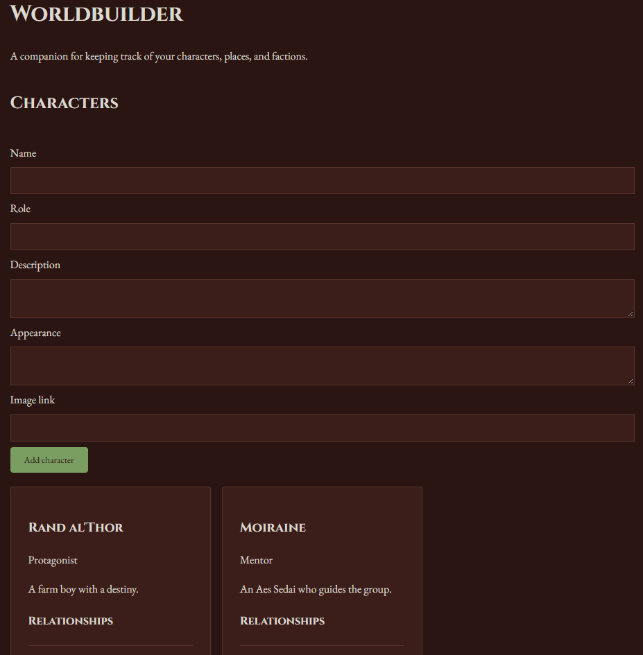

# Worldbuilder App
This app allows authors to enter and keep track of information about their characters, places and factions.

[Live site](https://j-winchester94.github.io/worldbuilder/)

## Features
- Uses localStorage to save entries that the user inputs
- Allows users to add new characters, places, and factions using a form.
- Page updates when users add information
- Asks users to confirm if they wish to delete an entry
- Edit any entry in place, with Save and Cancel options
- Visual details for every entry, with section specific labels, Appearance, Landscape, Symbols & Colors
- Images on entries by link
- Relationships between entries: characters, places, and factions in any combination with custom labels like "born in" or "mentor of"
- Adding and removing relationships right from the cards
- Deleting an entry also removes its relationships, with a confirmation that says how many will be lost
- Export your entire world as a JSON file, and impoprt it back, with validation and a
confirmation before anything is replaced 

## Built with
- HTML5
- CSS
- React
- localStorage
- Vite

## What I learned 
- How to use components and props with useState and useEffect to create forms and save information to local storage
- How to refactor repeated code into a shared component, and controlled forms
- How React's one-way data flow works
- Why props are read-only
- Why key and id serve different purposes
- How to model relationships as a separate list of links, the way databases handle many-to-many connections
- How to look up entries by type and id with find, and an object used as a lookup table
- How to chain filter and map to transform data
- How to write reusable helper functions, so logic lives in one place
- Avoiding stale state when one form choice depends on another
- Boolean logic, like negating conditions correctly
- Using Git branches and pull requests to build features safely
- How to export and import JSON files

## Future improvements
- A map creator and/or uploader that allows users to see their world and bring up relevant information when clicked on or hovered over
- A feature that allows users to create a plot grid to help them map out their stories
- AI generated art to help authors visualize their work
- An interactive timeline that details the history and relationships of an entry
- How to create a downloadable file in the browser with Blobs and object URLs
- How to read user selected files using async and await
- How to validate data before trusting it
- How to use try, catch and finally for error handling and cleanup
