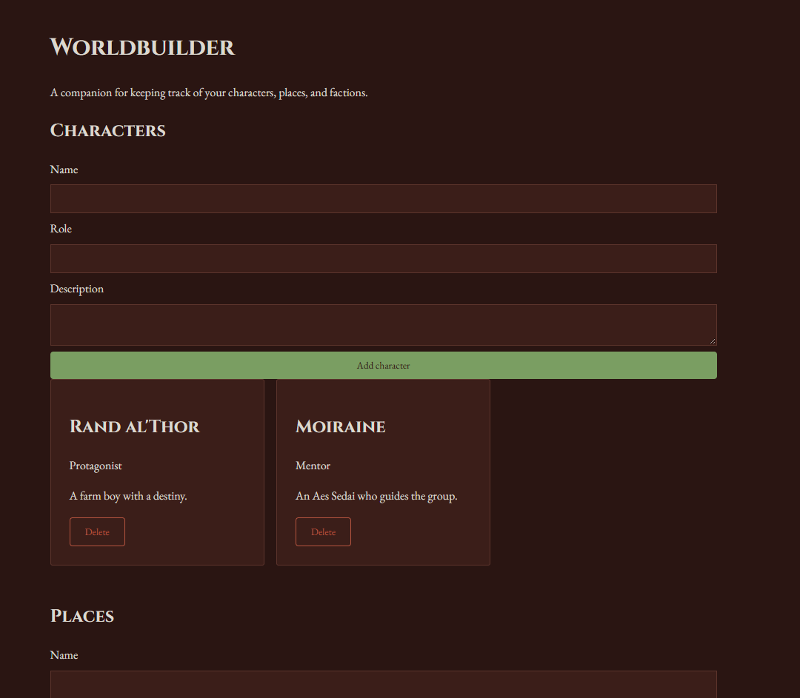

# Worldbuilder App
This app allows authors to enter and keep track of information about their characters, locations and factions.

[Live site](https://j-winchester94.github.io/worldbuilder/)

## Features
- Uses localStorage to save entries that the user inputs
- Allows users to add new characters, locations, and factions using a form.
- Page updates when users add information
- Asks users to confirm if they wish to delete an entry

## Built with
- HTML5
- CSS
- React
- localStorage
- Vite

## What I learned
Learning React was an interesting experience and introduced me to concepts such as using components and props with useState and useEffect to create forms and save information to local storage, refactoring repeated code into a shared component, and controlled forms.

## Future improvements
- Links that automatically update within a character bio that allows users to pull up relevant information. (Ex. character is from city)
- A map creator and/or uploader that allows users to see their world and bring up relevant information when clicked on or hovered over
- A feature that allows users to create a plot grid to help them map out their stories
